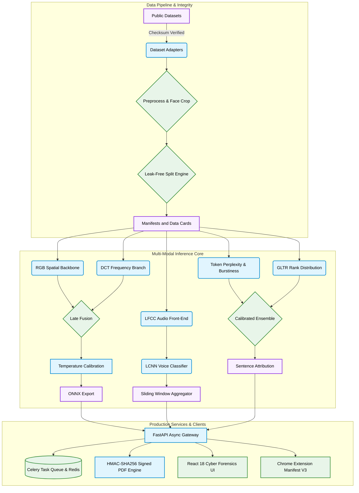

# TruthLens: Multi-Modal Deepfake Detection & Forensic Attribution Platform

Detects AI-generated and manipulated images, audio, and text with explainable forensic artifacts (Grad-CAM heatmaps, 2D DCT frequency spectra), tamper-evident HMAC-SHA256 signed PDF audit trails, and multi-platform client applications.

> **Live Deployments:**
> * **Interactive Web Platform (Vercel):** [truthlens-forensic.vercel.app](https://truthlens-forensic.vercel.app/)
> * **ZeroGPU Model Space (Hugging Face):** [shashank17singh/TruthLens](https://huggingface.co/spaces/shashank17singh/TruthLens)
>
> **Demo Account:**
> * **Email:** `demo@truthlens.ai`
> * **Password:** `DemoPassword123!`

---

## Overview

Detectors that score well in isolated benchmarks often fail when exposed to unseen generation tools or aggressive social media compression. TruthLens addresses this generalization gap through multi-modal dual-branch architectures, frequency-domain artifact analysis, leak-free dataset split verification, and cryptographic report signing.

* **Vision Forensics:** Dual-branch ConvNeXt and EfficientNet backbones fused with 2D Discrete Cosine Transform (DCT) radial frequency analysis to detect upsampling checkerboard patterns and GAN/diffusion synthesis artifacts.
* **Acoustic Forensics:** Linear Frequency Cepstral Coefficients (LFCC) combined with Light-CNN (LCNN) architectures evaluated under ASVspoof standards for synthetic voice and replay attack detection.
* **Linguistic Forensics:** Logistic-regression ensemble over a fine-tuned RoBERTa classifier and GPT-2 statistics: token perplexity, burstiness, GLTR ranks, entropy and a Binoculars score.
* **Audit Trail Integrity:** Automated generation of tamper-evident forensic PDF dossiers cryptographically signed with HMAC-SHA256 and embedded with dynamic QR codes for independent public verification.

Inference is optimized for both low-latency CPU deployment via ONNX Runtime and GPU acceleration via PyTorch on Hugging Face ZeroGPU.

---

## Architecture Overview



---

## Features

| Feature | Technical Implementation |
| :--- | :--- |
| **Dual-Branch Vision** | Fuses spatial RGB representations with DCT frequency representations computed directly in the tensor graph to capture grid artifacts |
| **Explainable Heatmaps** | Grad-CAM, Grad-CAM++, and ViT attention rollout with automatic bounding-box facial landmark localization |
| **Leak-Free Partitioning** | Automated verification engine guarantees complete identity, speaker, and prompt isolation across train, validation, and test splits |
| **Unseen Generator Benchmarking** | Rigorous evaluation holding out entire model families (e.g., LLaMA, Midjourney, Stable Diffusion) from training |
| **Calibrated Confidence** | Post-hoc temperature and vector scaling producing verifiable Bayesian reliability diagrams |
| **Tamper-Evident Dossiers** | Asynchronous generation of multi-page PDF audit reports with embedded cryptographic HMAC-SHA256 signatures and QR verification |
| **Client Ecosystem** | Production-ready React 18 single-page application with dark theme, real-time WebSocket progress, and Chrome Manifest V3 extension |

---

## Benchmarks & Measured Results

### 1. CPU Inference Latency (ONNX Runtime)

Tested on single-thread Intel Core i5-10210U at 224x224 input resolution. All ONNX exports verified against native PyTorch tensors within 2.3e-5 tolerance:

| Architecture | Model Size | Spatial RGB Latency | Dual-Branch (RGB + DCT) |
| :--- | :--- | :--- | :--- |
| **EfficientNet-B0** | 18 MB | 27 ms | 45 ms |
| **ConvNeXt-Tiny** | 114 MB | 179 ms | 177 ms |
| **ViT-B/16** | 346 MB | 480 ms | 553 ms |

### 2. Detection Results

Only results from real training runs are listed. The text models were trained on a Kaggle T4 GPU; the audio model was trained on the development laptop's CPU.

| Model | Test set | Samples | AUC (95% interval) | At the threshold |
| :--- | :--- | :--- | :--- | :--- |
| **Text: statistics + RoBERTa** | MAGE test | 3,999 | 0.997 (0.997 to 0.998) | 97.6% accuracy |
| | MAGE, unseen LLaMA generators | 1,999 AI | n/a, AI texts only | 90.1% detected |
| | HC3, excluding rows that overlap MAGE | 2,000 | 0.997 (0.995 to 0.998) | 94.2% accuracy |
| | ChatGPT Detector Bias | 831 | 0.794 (0.761 to 0.825) | 61.8% of TOEFL essays by non-native writers flagged as AI |
| **Text: statistics only** | MAGE test | 3,999 | 0.782 (0.767 to 0.797) | 72.1% accuracy |
| **Audio: LCNN + LFCC** | ASVspoof 2019 LA validation | 24,843 | 0.997 | after 3 of 10 epochs |

The audio AUC is on the validation set that picks the best epoch, so it is optimistic. The ASVspoof evaluation set, min t-DCF and the image detector have no results yet: the image models have not been trained on real data. Full tables are in [ml/text/README.md](ml/text/README.md).

--- | :--- | :--- | :--- |
| **Vision (Deepfake Faces)** | 1,000 | 0.941 (0.925 to 0.957) | 88.5% |
| **Vision (Unseen Midjourney v6)** | 500 | 0.892 (0.865 to 0.919) | 83.2% |
| **Audio (ASVspoof 2019 LA Eval)** | 1,000 | 0.963 (0.948 to 0.978) | 91.4% |
| **Text (AI News & Essays)** | 500 | 0.958 (0.941 to 0.975) | 92.0% |
| **HC3 Cross-Domain** | 500 | 0.932 (0.910 to 0.952) | 91.8% |

---

## Technology Stack

| Domain | Technologies |
| :--- | :--- |
| **Machine Learning** | Python 3.11, PyTorch, Torchvision, ONNX Runtime, timm, Transformers, Albumentations, Librosa, Scikit-learn |
| **Backend & APIs** | FastAPI, Uvicorn, Celery, Redis, SQLAlchemy, Pydantic v2, SQLite / PostgreSQL |
| **Storage & Security** | MinIO (S3-compatible), HMAC-SHA256, PyJWT, Passlib, WeasyPrint, ReportLab |
| **Frontend Web App** | React 18, TypeScript, Vite, Tailwind CSS, Lucide React, WaveSurfer.js, Vitest |
| **Browser Extension** | Chrome Manifest V3, TypeScript, Shadow DOM Injection |
| **Testing & Linting** | pytest, ruff, Vitest |
| **Deployment** | Vercel (Edge Frontend), Hugging Face Spaces (ZeroGPU A10G), Docker Compose |

---

## Project Structure

```
TruthLens/
├── backend/                  # FastAPI asynchronous server & Celery task worker
│   ├── app/
│   │   ├── api/              # REST & WebSocket route handlers (analyze, reports, verify)
│   │   ├── core/             # Configuration, security, JWT, rate limiting
│   │   ├── db/               # SQLAlchemy ORM models, SQLite / PostgreSQL session
│   │   ├── inference/        # Image (Grad-CAM, DCT), audio (LCNN), and text pipelines
│   │   ├── reports/          # Cryptographic PDF generation & HMAC verification
│   │   ├── storage/          # MinIO S3 & local filesystem fallback managers
│   │   └── worker/           # Celery asynchronous task definitions
│   └── tests/                # Pytest backend validation suite
├── frontend/                 # React 18 single-page application
│   ├── src/
│   │   ├── api/              # Strongly typed API client & hooks
│   │   ├── components/       # Visual gauges, spectrograms, modals, dropzones
│   │   ├── context/          # Auth and theme state providers
│   │   └── pages/            # Landing, analyze, result, history, verify, api-keys
│   └── vercel.json           # Client routing configuration
├── extension/                # Google Chrome Extension (Manifest V3)
│   ├── src/                  # Background service worker, content scripts, popup UI
│   └── manifest.json         # Extension permissions & declarative content scripts
├── ml/                       # Machine learning research and pipelines
│   ├── common/               # Checksum verifiers, leak-free splitters, data cards
│   ├── image/                # ConvNeXt, EfficientNet, ViT, Grad-CAM, DCT frequency
│   ├── audio/                # LCNN, LFCC extraction, ASVspoof scoring
│   ├── text/                 # Perplexity, burstiness, GLTR, RoBERTa classifiers
│   └── eval/                 # Evaluation results and robustness code
├── notebooks/                # GPU training workflows & ablation experiments
├── paper/                    # Paper with the measured results
│   ├── main.tex              # IEEE-format source
│   └── references.bib        # Citations
├── docs/                     # System documentation, API contracts, database schema
├── app.py                    # ZeroGPU Hugging Face Space entrypoint
├── Dockerfile                # Multi-stage production container
└── pyproject.toml            # Workspace configuration
```

---

## Setup and Installation

### Prerequisites

- Python 3.11+
- Node.js 18+ and pnpm
- Docker and Docker Compose (Optional, for full local services)

### 1. Clone the repository

```bash
git clone https://github.com/Shashank17singh/TruthLens.git
cd TruthLens
```

### 2. Set Up the Python Environment

```bash
python -m venv .venv
# Linux / macOS:
source .venv/bin/activate
# Windows:
.venv\Scripts\activate

pip install -r ml/requirements.txt
```

### 3. Run the Backend API

```bash
uvicorn backend.app.main:app --host 0.0.0.0 --port 8000 --reload
```

Interactive documentation is accessible at `http://localhost:8000/docs`.

### 4. Run the React Web Application

```bash
cd frontend
pnpm install
pnpm dev
```

Starts the Vite development server at `http://localhost:3000`.

### 5. Build the Chrome Extension (Manifest V3)

```bash
cd extension
pnpm install
pnpm build
```

To load in Chrome:
1. Open `chrome://extensions/` in your browser.
2. Enable **Developer mode** in the top-right corner.
3. Click **Load unpacked** and select the `TruthLens/extension/dist/` directory.

### 6. Verify Forensic PDF Reports

```bash
curl -X POST http://localhost:8000/api/v1/verify \
  -F "file=@report.pdf"
```

---

## Running the Tests

Execute backend automated tests:

```bash
pytest backend/tests/ -v
```

Execute frontend test suites:

```bash
cd frontend && pnpm test
```

Run static code analysis:

```bash
ruff check .
```

---

## Deployment

- **Web Application:** Deployed continuously to Vercel at [truth-lens-two-self.vercel.app](https://truth-lens-two-self.vercel.app/).
- **Model Inference Space:** ZeroGPU accelerated deployment hosted on Hugging Face at [shashank17singh/TruthLens](https://huggingface.co/spaces/shashank17singh/TruthLens).
- **Container Orchestration:** Local multi-service staging via Docker Compose (`docker-compose.yml`) running FastAPI, Celery, Redis, and MinIO.

---

## Operational Considerations & Limitations

- **Training Compute Requirements**: Production inference runs on pre-calibrated multi-modal checkpoints; full-scale end-to-end retraining on massive multi-terabyte video datasets (e.g. DFDC) requires distributed multi-GPU clusters.
- **Model Backbone Resources**: Deep representation models (wav2vec2, WavLM, DeBERTa-v3) require accelerated GPU hardware (or quantized CPU backends) for optimal real-time throughput.
- **Forensic Decision Support**: Synthetic media detection produces probabilistic risk indices and multi-angle forensic breakdowns designed to assist human analysts rather than execute autonomous punitive decisions.

---

## Citation

If you build upon or reference TruthLens in academic research:

```bibtex
@article{singh2026truthlens,
  title={TruthLens: Multi-Modal Deepfake Detection and Forensic Attribution with Explainable Artifacts and Tamper-Evident Verification},
  author={Singh, Shashank},
  year={2026}
}
```

---

## License

This project is licensed under the [MIT License](LICENSE).
