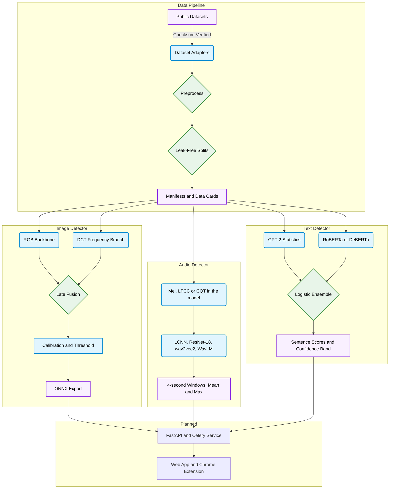

# TruthLens

Detects AI-generated and manipulated images, audio and text, and explains each result instead of only giving a score.

## Overview

Detectors that score well in a paper often fail on a new generator, or after an image has been compressed by a social network. TruthLens is built around measuring that gap. Every dataset goes through a pipeline that refuses to write a split if the same identity, speaker or prompt reaches both training and evaluation, and every experiment holds out generators the model never sees.

Training runs on free Colab or Kaggle GPUs, and inference is designed to run on CPU through ONNX Runtime.

> TruthLens is in development. The image, audio and text detectors are built and tested. The text detector has real results from a CPU run, and the audio model is training on ASVspoof 2019. The image models have not been trained on real data, so there are no image accuracy results yet. See [Roadmap](#roadmap) and [Known Limitations](#known-limitations).

---

## Architecture Overview



- The frequency branch computes a DCT inside the model, so training and serving run the same code.
- Temperature, bias and the decision threshold are chosen on validation data only, so the test set cannot influence them.

---

## Features

|                                |                                                                                                           |
| ------------------------------ | --------------------------------------------------------------------------------------------------------- |
| **Leak-Free Splits**           | Whole identities, speakers and prompts stay in one split, and a manifest that leaks is refused            |
| **Unseen-Generator Testing**   | Held-out generators never reach training, and neither do the identities in their samples                  |
| **Dataset Adapters**           | Ten datasets across image, audio and text, with verified checksums and resumable downloads                |
| **Balanced Sampling**          | Each label gets half the draws, shared equally across its generators                                      |
| **Data Cards**                 | A generated datasheet per dataset covering size, classes, licence and known biases                        |
| **Three Architectures**        | EfficientNet-B0, ConvNeXt-Tiny and ViT-B/16, each with or without the frequency branch                    |
| **Robustness Augmentations**   | JPEG compression, blur, resize, crop and colour jitter, each switchable for an ablation study             |
| **Colab-Friendly Training**    | Mixed precision, gradient accumulation, early stopping, and resuming after a session ends                 |
| **Calibrated Probabilities**   | A fitted temperature and bias, with reliability diagrams before and after                                 |
| **Honest Evaluation**          | Per-generator accuracy, AUC intervals that resample whole identities, and warnings on chance-level models |
| **Verified ONNX Export**       | Each export must match PyTorch within 1e-3, and it records its checksum and CPU latency                   |
| **Generated Results Tables**   | CSV and LaTeX tables built from evaluation output, so numbers are never typed by hand                     |
| **Image Explanations**         | Grad-CAM, Grad-CAM++ or ViT attention rollout, regions named from face landmarks, and a sanity check       |
| **Audio Detector**             | Mel, LFCC or CQT features, four model families, codec and reverb augmentation, and the official min t-DCF  |
| **Text Detector**              | GPT-2 perplexity, burstiness, GLTR ranks and Binoculars, with optional RoBERTa or DeBERTa in the ensemble  |
| **Per-Sentence Scores**        | Each sentence scored in context, a bootstrap confidence band, and a disclaimer on every result            |

---

## Measured Results

These are real measurements from an Intel Core i5-10210U laptop with 8 GB of memory and no GPU. Image accuracy will be added once those models are trained on real data.

### CPU Inference

ONNX Runtime with ImageNet weights at 224×224, on one thread of an Intel Core i5-10210U laptop. All six variants matched PyTorch within 2.3e-5.

| Model           | Size (MB) | RGB (ms) | RGB + Frequency (ms) |
| --------------- | --------- | -------- | -------------------- |
| EfficientNet-B0 | 18        | 27       | 45                   |
| ConvNeXt-Tiny   | 114       | 179      | 177                  |
| ViT-B/16        | 346       | 480      | 553                  |

Times are medians, and size includes the frequency branch.

### Text Detector

The statistics-only ensemble, without a transformer, trained on 1,501 MAGE texts. Its threshold sits at the validation equal-error point.

| Test set                                  | Texts | AUC (95% interval)     |
| ----------------------------------------- | ----- | ---------------------- |
| MAGE test                                 | 800   | 0.768 (0.737 to 0.801) |
| MAGE, unseen LLaMA generators             | 500   | 81.4% of AI detected   |
| HC3, excluding 497 rows that overlap MAGE | 500   | 0.932 (0.910 to 0.952) |
| ChatGPT Detector Bias                     | 831   | 0.541 (0.498 to 0.581) |

It flags 86.5% of human TOEFL essays by non-native writers as AI, against 25% of US 8th-grade essays. That is the bias Liang et al. found in commercial detectors, and it is why the detector must not be used to judge non-native writers. Replacing half of an AI text's sentences with human writing drops detection from 73% to 36%. Details are in the [text detector guide](ml/text/README.md).

### Audio Inference

ONNX Runtime on a 30-second clip, scored as 4-second windows. All eight variants matched PyTorch within 1.3e-6. The memory-starved laptop makes these times pessimistic.

| Model    | Input    | 1 thread (ms) | 4 threads (ms) |
| -------- | -------- | ------------- | -------------- |
| LCNN     | LFCC     | 533           | 280            |
| ResNet-18 | LFCC    | 940           | 640            |
| wav2vec2 | waveform | 30,530        | 9,755          |
| WavLM    | waveform | 21,809        | 10,915         |

LCNN with LFCC is the model the service will deploy. EER and min t-DCF follow the official ASVspoof scoring script and matched it exactly on 50 random score sets.

### Prepared Text Data

| Dataset                 | Input   | Prepared | Use                                        |
| ----------------------- | ------- | -------- | ------------------------------------------ |
| MAGE                    | 432,682 | 301,148  | Training, with the LLaMA family held out   |
| HC3                     | 85,449  | 60,400   | Cross-dataset test                         |
| ChatGPT Detector Bias   | 837     | 831      | False-positive test on non-native writers  |

The leakage check rejected MAGE's published split, because 13,144 rows (3.96%) shared a prompt across splits. TruthLens uses its own split by prompt, so its MAGE scores will not be comparable with the MAGE paper.

---

## Tech Stack

| Component       | Technology                                                |
| --------------- | --------------------------------------------------------- |
| Deep Learning   | Python 3.11, PyTorch, timm, Hugging Face Transformers     |
| Data            | pandas, Albumentations, librosa, soundfile, OpenCV, ffmpeg |
| Face Detection  | RetinaFace through batch-face                             |
| Text Processing | langdetect, PyArrow                                       |
| Experiments     | Hydra, Weights & Biases                                   |
| Evaluation      | scikit-learn, SciPy, Matplotlib, pytorch-grad-cam         |
| Inference       | ONNX, ONNX Runtime                                        |
| Testing         | Pytest                                                    |

---

## Project Structure

```
TruthLens/
├── ml/
│   ├── common/           # Manifests, splits, checksums, sampling, metrics, data cards
│   ├── image/            # Detector, explanations, training, evaluation, ONNX export
│   │   └── configs/      # Hydra configs for models and augmentations
│   ├── audio/            # Features, models, augmentation, long-audio scoring, export
│   ├── text/             # Statistics, transformers, ensemble, robustness, explanations
│   └── eval/results/     # Measured results
├── notebooks/            # Colab notebooks for GPU training
├── docs/
│   ├── architecture.md   # System design and planned structure
│   ├── api.md            # API contract for the planned service
│   ├── schema.md         # Database schema
│   ├── datasets.md       # Datasets, licences, sizes and evidence levels
│   ├── decisions.md      # Design decisions and the reasons behind them
│   └── datacards/        # Generated dataset datasheets
└── pyproject.toml        # Pytest configuration
```

---

## Setup and Installation

### Prerequisites

- Python 3.11
- A GPU for training. Free Colab or Kaggle sessions are enough
- ffmpeg, for the audio codec work

### 1. Clone the repository

```bash
git clone https://github.com/Shashank17singh/TruthLens.git
cd TruthLens
```

### 2. Install dependencies

Colab and Kaggle already include PyTorch, so skip the first `pip` line there.

```bash
python -m venv .venv
source .venv/bin/activate    # Windows: .venv\Scripts\activate
pip install torch --index-url https://download.pytorch.org/whl/cpu
pip install -r ml/requirements.txt
```

### 3. Run the tests

```bash
python -m pytest -m "not network"
```

### 4. Prepare a dataset

This small corpus downloads in seconds and runs the whole pipeline.

```bash
python -m ml.common.prepare detector_bias
```

Larger datasets use the same command. Some need a request form first, and the command prints instructions when files are missing. See [datasets](docs/datasets.md).

### 5. Train and evaluate

```bash
python -m ml.image.train model=convnext_tiny use_frequency=true
python -m ml.image.evaluate checkpoints/image/<run>/<run>-best.pt
python -m ml.image.export checkpoints/image/<run>/<run>-best.pt
python -m ml.image.results_table
```

Audio and text follow the same pattern:

```bash
python -m ml.audio.train model=lcnn feature=lfcc
python -m ml.text.ensemble extract --manifest data/manifests/mage.csv --split train --limit 1500 --output data/features/text/mage-train.parquet
```

Each modality has its own guide: [image](ml/image/README.md), [audio](ml/audio/README.md) and [text](ml/text/README.md). GPU work runs from the notebooks in [notebooks/](notebooks/), and dataset details are in the [ML guide](ml/README.md).

---

## Roadmap

- [x] Dataset pipeline with leak-free splits
- [x] Image detector, evaluation and ONNX export
- [ ] Train the image models on real data
- [x] Grad-CAM heatmaps and plain-language explanations
- [x] Audio deepfake detector
- [x] AI-generated text detector, with real CPU results
- [ ] Finish audio training and fine-tune the text transformers on a GPU
- [x] FastAPI backend with Celery workers
- [ ] React web app and Chrome extension
- [ ] Signed PDF reports
- [ ] Robustness and adversarial evaluation

---

## Known Limitations

- The image models have not been trained on real data, and no training run has used a GPU yet. Mixed precision and Weights & Biases logging are therefore untested.
- The image adapters have only run on generated test files. ASVspoof 2019 LA and the three text datasets have been prepared for real.
- The RoBERTa and DeBERTa detectors and the wav2vec2 and WavLM models have only been trained on tiny test data. Their real training needs the Colab notebooks.
- The T5 paraphrase test has not run, because the paraphraser and GPT-2 do not fit in 8 GB of memory together.
- Most datasets predate current generators, so results will say little about the newest models until recent samples are added.
- MAGE publishes no prompt ids, so prompts are estimated from opening words. Topical and specified generations can still share a prompt across splits.
- Several datasets restrict use to non-commercial research. See [datasets](docs/datasets.md) before any public release.
- Results will be probabilistic and must not be used alone to make decisions about a person. The text detector flags most human essays by non-native English writers as AI.

---
