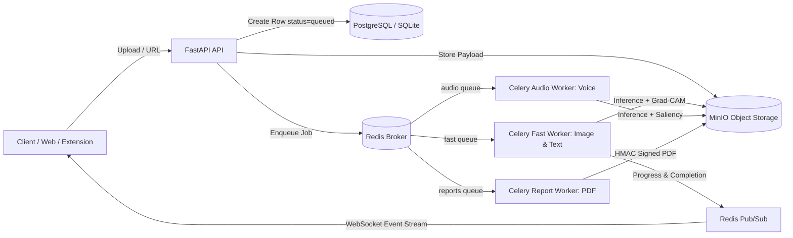

# TruthLens Async Inference Backend

The backend service for TruthLens handles media upload, SSRF-safe URL fetching, EXIF stripping, asynchronous inference queues, explainability artifact generation, WebSocket progress notifications, and signed PDF report generation.

## Architecture & Request Flow



## Features

- **Multi-Modal Endpoints**:
  - `POST /api/v1/analyze/image`: Multipart image upload (JPEG, PNG, WebP up to 10 MB). Strips EXIF metadata, scans for threats, and runs ConvNeXt/EfficientNet/ViT ONNX models.
  - `POST /api/v1/analyze/audio`: Multipart audio upload (WAV, MP3, FLAC, OGG, M4A up to 25 MB / 5 min). Evaluates 4-second sliding windows with LCNN LFCC detector.
  - `POST /api/v1/analyze/text`: JSON text analysis (up to 20,000 characters). Runs GPT-2 statistical ensemble with per-sentence scoring and confidence band.
  - `POST /api/v1/analyze/url`: Asynchronous SSRF-safe media fetcher that verifies destination IPs are public, limits redirects, and routes to image or audio pipelines.
- **Model Registry (`models.yaml`)**:
  - Loads models once per worker process during `worker_process_init`.
  - Records model name, version, and calibrated decision threshold with every result.
- **Explainability & Artefacts**:
  - Generates Grad-CAM overlays, DCT frequency spectra, and audio spectrogram saliency maps, stored in MinIO and accessible via presigned URLs.
- **Authentication & Rate Limiting**:
  - Web users: 15-minute JWT access tokens + 7-day HttpOnly refresh cookies (60 requests/min).
  - Extensions & Public API: API keys with SHA-256 key hashing (`tl_...`) and configurable per-key rate limits (default 30 req/min).
  - Unauthenticated endpoints: Rate limited to 10 requests/min per IP.
- **24-Hour Privacy Purge**:
  - Celery Beat hourly task automatically purges media files, generated artefacts, and stored sentence text after 24 hours unless `POST /analyses/{id}/save` is called (`retain_media: true`).
- **Tamper-Evident Signed Reports**:
  - Generates PDF reports with SHA-256 hash, HMAC signature, and public verification QR code.
  - Anyone can upload a PDF to `POST /api/v1/verify` to confirm authenticity.

---

## Running the Backend

### Prerequisites

Activate the virtual environment and ensure dependencies are installed:

```bash
source .venv/bin/activate    # On Windows: .venv\Scripts\activate
pip install -r backend/requirements.txt
```

### 1. Start the API Server

```bash
uvicorn backend.app.main:app --host 0.0.0.0 --port 8000 --reload
```

Interactive OpenAPI documentation is available at `http://localhost:8000/api/v1/docs`.

### 2. Start Celery Workers

```bash
# Start worker handling fast, audio, and report queues
celery -A backend.app.worker.celery_app worker -Q fast,audio,reports -l info
```

### 3. Start Celery Beat (Media Purge Scheduler)

```bash
celery -A backend.app.worker.celery_app beat -l info
```

### 4. Run the Test Suite

```bash
pytest backend/tests
```
