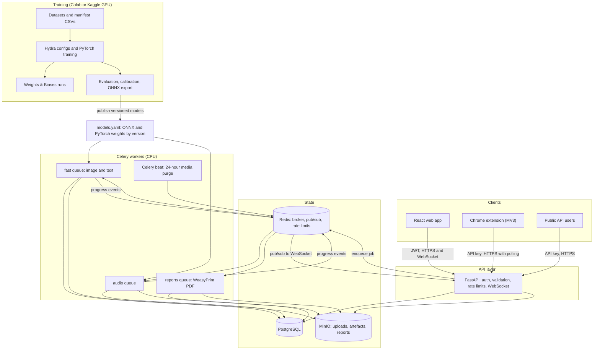

# Architecture

TruthLens has two halves that meet at a versioned model registry. Training happens on free GPUs in notebooks and scripts. Serving happens on CPU behind an asynchronous API.

## System diagram



## Request flow

1. The client posts a file, text or URL. The API authenticates it and checks the rate limit.
2. For direct uploads, the API checks magic numbers and size limits, strips EXIF and runs the virus-scan hook. A URL job runs those same checks in the worker after the download.
3. The media goes to MinIO and an `analyses` row is created with status `queued`. The API returns `202` with the analysis id.
4. A Celery worker runs ONNX inference, then builds the explanation with the PyTorch weights.
5. The worker writes `analysis_results`, stores artefacts in MinIO and publishes progress to Redis.
6. The API relays events to the browser over WebSocket. The extension polls `GET /analyses/{id}` instead.
7. Celery beat deletes unsaved media, artefacts and stored source text 24 hours after upload.

## Monorepo structure

```text
TruthLens/
├── ml/
│   ├── common/             # Seeds, manifests, splits, samplers, metrics, data cards
│   │   └── tests/          # Includes the no-file-in-two-splits tests
│   ├── image/              # Models, training, evaluation, export, explain.py
│   │   └── configs/
│   ├── audio/              # Features, models, training, evaluation, export, saliency
│   │   └── configs/
│   ├── text/               # Statistical features, transformers, ensemble, robustness
│   │   └── configs/
│   └── eval/               # robustness.py, results notebook
│       └── results/        # Results CSVs consumed by the paper
├── backend/
│   ├── app/
│   │   ├── api/            # Routers and WebSocket handlers
│   │   ├── core/           # Settings, auth, rate limits, logging
│   │   ├── db/             # SQLAlchemy models and Alembic migrations
│   │   ├── inference/      # Model registry, ONNX sessions, per-modality pipelines
│   │   ├── reports/        # Jinja2 templates, QR codes, HMAC signing
│   │   ├── storage/        # MinIO client
│   │   ├── validation/     # Magic numbers, EXIF, URL fetching, virus-scan hook
│   │   └── worker/         # Celery app, tasks, purge schedule
│   ├── models.yaml
│   └── tests/
├── frontend/
│   └── src/
│       ├── api/            # Typed client and React Query hooks
│       ├── components/     # Gauge, heatmap, waveform, sentence highlights
│       ├── pages/          # Landing, Analyze, Result, History, API keys, Admin, Verify
│       └── test/
├── extension/
│   ├── src/
│   │   ├── background/     # Service worker and context menus
│   │   ├── overlay/        # Shadow DOM result overlay
│   │   ├── options/
│   │   └── popup/
│   └── scripts/            # Packages the .zip
├── infra/
│   ├── docker/             # Dockerfiles for api, worker, web
│   └── docker-compose.yml
├── paper/
│   ├── figures/
│   └── tables/
├── docs/
└── .github/workflows/
```

The master prompt lists `ml/image`, `ml/audio`, `ml/text` and `ml/common`. `ml/eval` is added because prompts 2.10 and 2.11 require `ml/eval/robustness.py` and `ml/eval/results/`.
